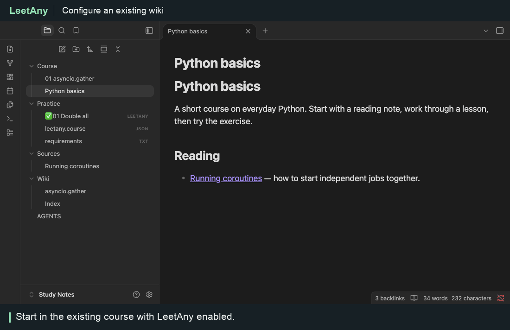
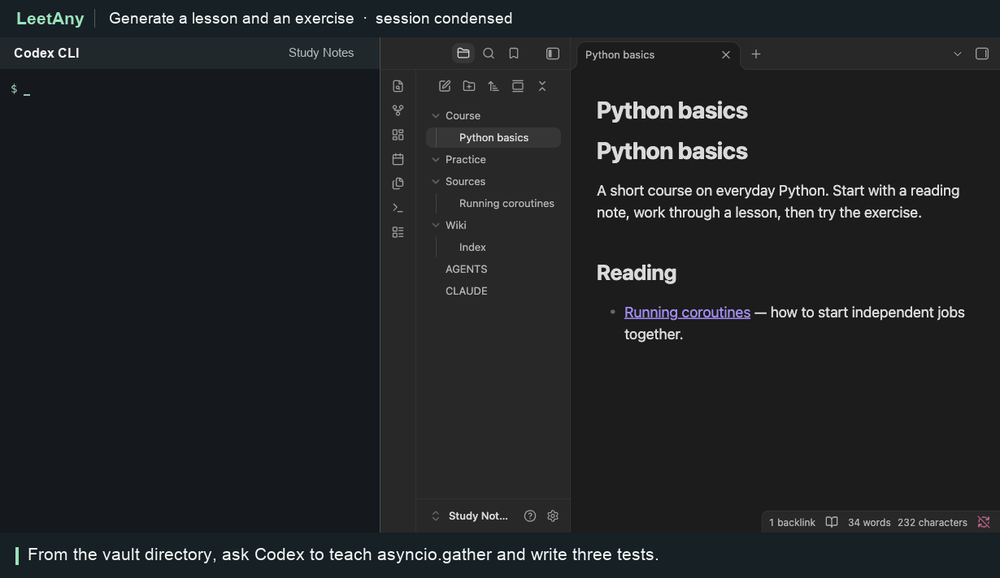

# From wiki notes to a runnable exercise

## 1. Configure an existing vault



With LeetAny enabled, open the command palette and run **LeetAny: Install course authoring skill**. It adds a skill pointer to the vault’s `AGENTS.md`. Keep your existing wiki instructions and add a course rule below that pointer. For example:

```text
Use the leetany-course skill for each coding exercise.
Keep Sources/ intact. Maintain one wiki page per concept in Wiki/.
Link each lesson, wiki page and exercise to one another.
Write three fixed cases with expected answers. Run the reference
against every case and leave the learner’s starter unfinished.
```

Choose **one** placement rule for this course:

| Layout | Line to add to the instructions |
| --- | --- |
| Beside each lesson | Put each .leetany file beside its lesson in Course/. Set lesson to the Markdown filename. |
| Separate practice folder | Put the .leetany files in Practice/. Set lesson to the vault-relative Markdown path, including .md. |

The recording chooses the second layout. For a course with its own dependencies, keep `leetany.course.json` beside its exercises and run environment setup in that directory.

## 2. Generate and solve an exercise



Open a terminal in the same vault. The recording shows a Codex CLI session beside Obsidian, with idle time shortened and progress output condensed. You can use the following prompt directly in Codex:

> Create a short Python lesson on asyncio.gather from the source note. Add a linked wiki page and a LeetAny exercise with three fixed tests. Verify the reference and starter.

In this vault, the source note asks for a synchronous `double_all(numbers)` entry point around an async worker. Codex writes a lesson under `Course/`, a concept under `Wiki/`, and **Double all** under `Practice/`. Follow the exercise link from the wiki and inspect **Case 3**: input `[7, 2]`, expected `[14, 4]`.

Inside `collect()`, schedule the workers and return their results:

```python
return await asyncio.gather(*(double(n) for n in numbers))
```

Click **Run tests**. The empty list, single number and two-number cases all pass. LeetAny shows **Accepted** and marks the exercise as solved in the file tree.

[Watch the narrated walkthrough of concurrent scheduling](async-python.md)
